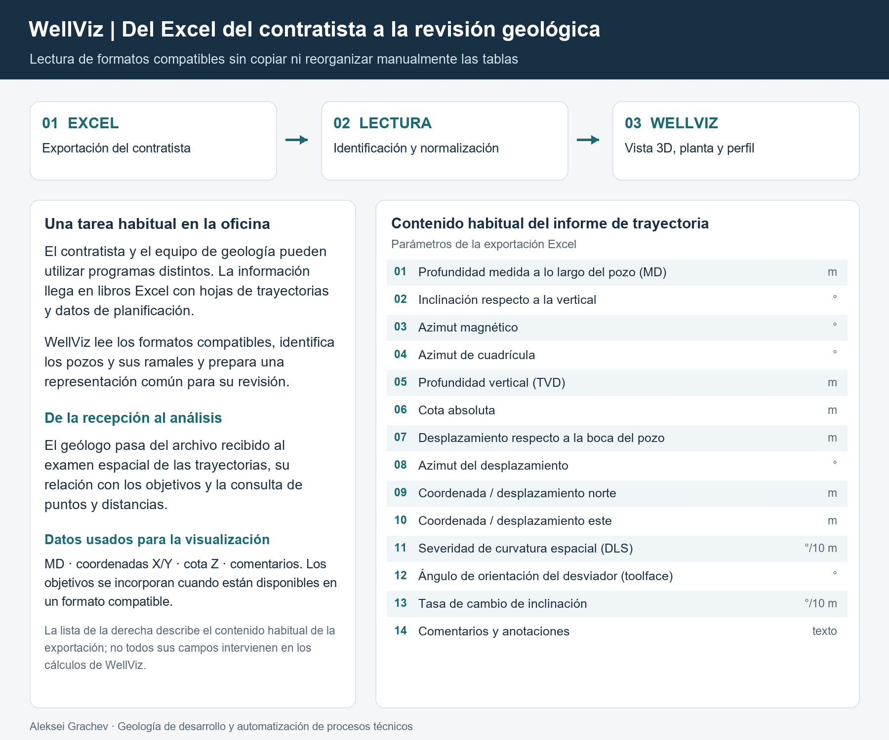
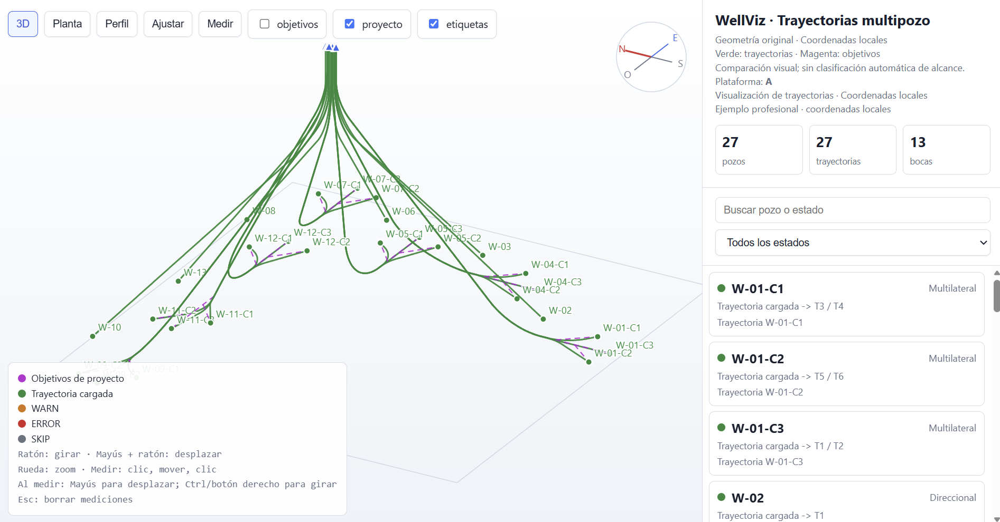
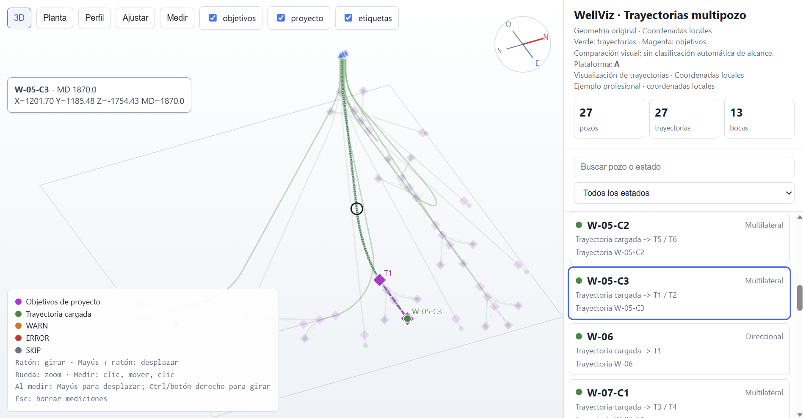
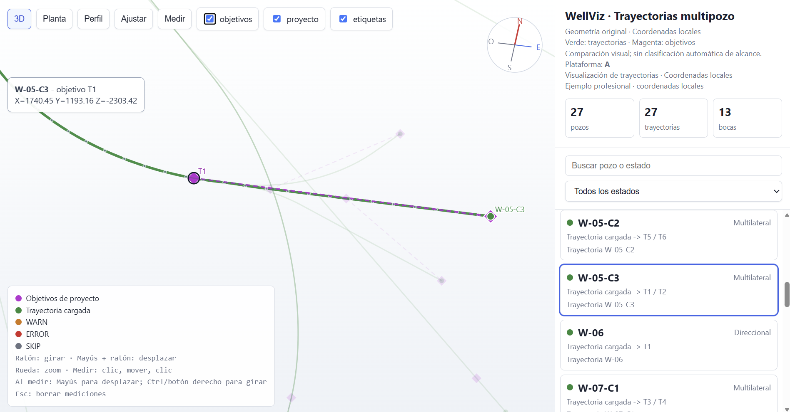

# WellViz - Visualización y revisión de trayectorias de pozos

Herramienta para visualizar rápidamente las trayectorias planificadas de pozos y compararlas con los objetivos geológicos. Permite revisar la documentación recibida sin transferir manualmente los datos a otro programa de visualización.

## Necesidad operativa

En la preparación de un programa de perforación intervienen ingenierías, contratistas y distintas áreas de la empresa. Estos equipos pueden utilizar programas diferentes, por lo que los resultados suelen intercambiarse mediante archivos Excel: informes de trayectoria, tablas de objetivos y esquemas de distribución de pozos.

Aunque estos documentos contienen la información necesaria, revisar la geometría espacial a partir de tablas independientes resulta poco práctico. Copiar columnas, reorganizar hojas y combinar archivos consume tiempo antes de comenzar el análisis técnico.

WellViz se desarrolló para facilitar una revisión ágil: recibir la documentación del proyectista, visualizarla en un entorno común e identificar los aspectos que requieren aclaración o corrección.

## Datos de entrada

La herramienta trabaja con formatos compatibles de exportación a Excel procedentes de software especializado en planificación de pozos.

Las fuentes incluyen tablas de trayectorias planificadas, información sobre bocas de pozo y cotas de referencia, y coordenadas de objetivos geológicos. Los datos pueden distribuirse entre varias hojas de un mismo libro o encontrarse en archivos separados.

Para representar las trayectorias se utilizan la profundidad medida a lo largo del pozo, las coordenadas espaciales, las cotas y los comentarios. El módulo de carga reconoce las estructuras previstas, relaciona los identificadores de pozos y ramales y normaliza los datos para su visualización conjunta.

## Funcionalidades

- Lectura de formatos Excel compatibles sin copiar datos ni reorganizar manualmente las tablas.
- Visualización conjunta de los pozos de una plataforma, incluidos los ramales de pozos multilaterales.
- Vistas en tres dimensiones, planta y perfil.
- Selección de pozos o ramales individuales, búsqueda y filtrado.
- Representación de los objetivos de proyecto mediante un color diferenciado para compararlos visualmente con las trayectorias.
- Consulta de coordenadas, profundidad medida y comentarios en puntos de la trayectoria.
- Medición de distancias espaciales y diferencias de cota.
- Revisión de la posición relativa de las bocas, las trayectorias y los objetivos para comprobar la coherencia de la documentación.
- Apertura del resultado interactivo en un navegador.

Cuando los datos están disponibles en un formato compatible, el módulo de comprobación también compara la última estación de la trayectoria con el objetivo final asignado, presenta las desviaciones en planta y en cota y comprueba la posición de la boca del pozo. La demostración presentada muestra la comparación visual de trayectorias y objetivos.

## Resultados y valor aportado

Durante la revisión de un programa de perforación, el geólogo debe comprobar tanto la disponibilidad de los documentos como su coherencia: la relación entre las trayectorias y los objetivos definidos, las cotas de referencia, la disposición de las bocas, los desplazamientos entre grupos de pozos y la correspondencia de identificadores y secuencias.

WellViz reúne información tabular dispersa en una representación espacial comprensible. Esto permite pasar con mayor rapidez de la recepción de los archivos a su revisión, detectar discrepancias y formular preguntas concretas al proyectista.

La herramienta reduce las tareas repetitivas de preparación de datos y facilita la comunicación entre especialistas. En lugar de explicar una observación mediante varias tablas, es posible mostrar el ramal seleccionado, sus objetivos y el tramo de interés en una misma escena interactiva.

WellViz está orientado a la revisión preliminar de la geometría y la coherencia de los datos. Ayuda a identificar cuestiones que deben analizar los especialistas correspondientes, sin sustituir los cálculos de cargas mecánicas, la evaluación de ingeniería del diseño del pozo ni los análisis especializados de anticolisión.

## Mi contribución

A partir de mi experiencia en la revisión y coordinación de programas de perforación, definí los requisitos y desarrollé una solución para preparar y visualizar espacialmente los datos de proyecto.

Implementé la lectura de formatos Excel compatibles, la comparación de trayectorias con objetivos geológicos, la selección de pozos y ramales y las herramientas de medición.

## Demostración

Los materiales muestran una vista espacial general de una plataforma multipozo, un ramal seleccionado con sus objetivos de proyecto y el uso de las herramientas de visualización y medición.

La demostración conserva la geometría de trayectorias reales de proyecto. Los nombres e identificadores se han anonimizado y las coordenadas absolutas en planta se han sustituido por coordenadas locales, manteniendo las posiciones relativas y las distancias.

El material público incluye esta descripción, un esquema del tratamiento de datos, capturas de pantalla y una demostración en vídeo. No se publican el código fuente ni los archivos Excel de trabajo.
## Material visual

### Esquema de entrada y tratamiento de datos

### Capturas de la herramienta

### Vídeo de demostración
[Ver la demostración en vídeo](4.mp4)
